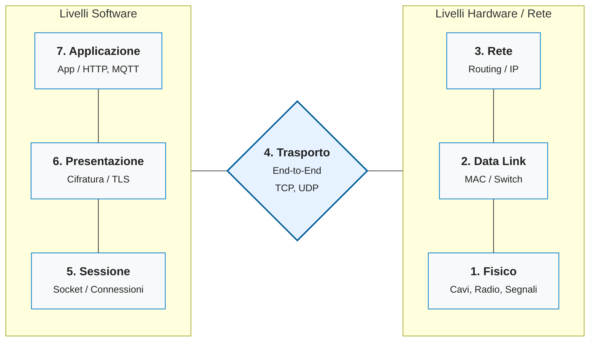

---
cssclasses:
  - smart-iot
tags:
  - network-infrastructure
aliases:
  - ISO OSI
  - ISO/OSI
---

> [!summary] Abstract
> Il modello ISO/OSI (Open Systems Interconnection) è un'architettura logica di rete sviluppata per standardizzare la comunicazione tra sistemi informatici. Suddivide l'intero processo di comunicazione in **7 livelli** gerarchici e indipendenti.

## Architettura

Ogni livello comunica solo con quello immediatamente superiore o inferiore e "incapsula" i dati aggiungendo le proprie informazioni (header) prima di passare il pacchetto al livello successivo.