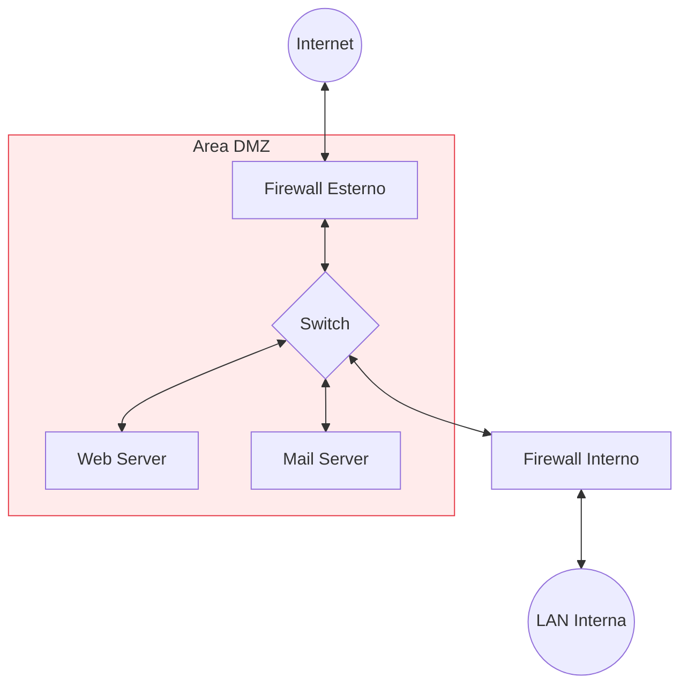

---
cssclasses:
  - smart-iot
tags:
  - network-infrastructure
  - secutiry
aliases:
  - DMZ
  - Demilitarized Zone
---
> [!summary] Abstract
> Una DMZ (Demilitarized Zone) è una **sottorete cuscinetto** che espone i servizi pubblici di un'organizzazione a una rete esterna non sicura (come Internet), aggiungendo un livello di isolamento per proteggere la rete interna (LAN) da accessi non autorizzati.

## Cos'è e come funziona
La DMZ funge da zona neutrale. I server che devono essere necessariamente accessibili dall'esterno (es. server web, DNS, server di posta, proxy) vengono posizionati in questa area. Il principio di base è che, qualora un attaccante riesca a compromettere uno di questi servizi esposti, si troverà comunque "ingabbiato" nella DMZ e dovrà superare un ulteriore firewall prima di poter accedere ai dati sensibili della LAN aziendale.

## Collocazione all'interno della rete
Ecco un tipico schema di rete con una configurazione DMZ (basata su un'architettura a doppio firewall per massimizzare la sicurezza):

> [!warning] Criticità e rischi
> - **Testa di ponte (Pivoting):** I server in DMZ sono la prima linea di difesa. Se violati, non danno accesso diretto alla LAN, ma forniscono all'attaccante un punto d'appoggio per studiare la rete interna e tentare attacchi mirati al firewall interno.
> - **Complessità (Misconfiguration):** Gestire correttamente le regole (ACL) tra Internet/DMZ e DMZ/LAN è complesso. Una singola regola firewall configurata male può creare un ponte diretto tra Internet e la LAN aziendale.
> - **Falsa sensazione di sicurezza:** La DMZ isola i sistemi, ma i server al suo interno rimangono esposti.

## Criticità nell'utilizzo con Smart IoT Device (Reti M2M)

Gestire dispositivi intelligenti (IoT) e traffico Machine-to-Machine (M2M) esponendoli o facendoli transitare in una DMZ introduce sfide di sicurezza profondamente critiche:

1. **Vulnerabilità degli endpoint IoT:** I dispositivi smart spesso mancano di sicurezza "by design" (password hardcoded, firmware non aggiornabili, risorse limitate per la crittografia). Collocarli in una DMZ li espone direttamente a scansioni ostili da Internet, rendendoli prede facilissime per botnet (es. *Mirai*).
2. **Abuso del traffico M2M per bypassare le policy:** In un'architettura M2M, i sensori devono necessariamente comunicare con i broker/server centrali (spesso situati nella LAN per l'elaborazione dati). Se per farli funzionare si aprono porte sul firewall interno (es. MQTT sulla porta 1883), un IoT compromesso nella DMZ può usare quel tunnel autorizzato per colpire direttamente la LAN.
3. **Mancanza di crittografia (Sniffing):** Molti protocolli M2M leggeri o legacy trasmettono in chiaro. Un attaccante che ha compromesso un nodo qualsiasi nella DMZ può intercettare questo traffico, rubare token di autenticazione o iniettare falsi dati sensoriali verso i sistemi di controllo interni.
4. **Cecità dei sistemi di monitoraggio:** Il traffico M2M è composto da micro-transazioni continue e ripetitive. Risulta estremamente difficile per i normali firewall o IDS situati a protezione della DMZ distinguere il traffico legittimo di telemetria da un attacco o da un'esfiltrazione dati lenta e silenziosa.
---
## Link di approfondimento
-  [wikipedia](https://it.wikipedia.org/wiki/Demilitarized_zone)
- [fortinet](https://www.fortinet.com/it/resources/cyberglossary/what-is-dmz)